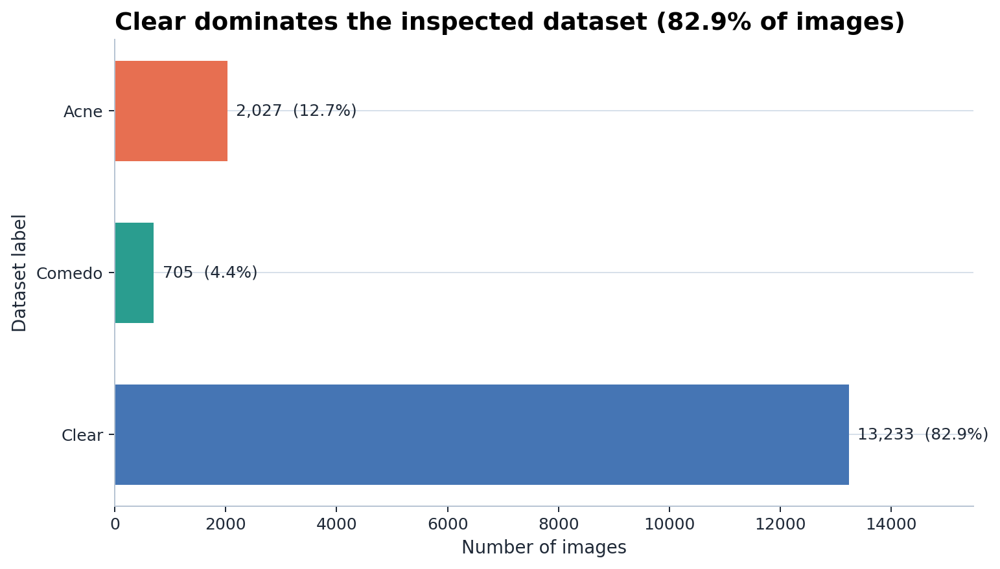
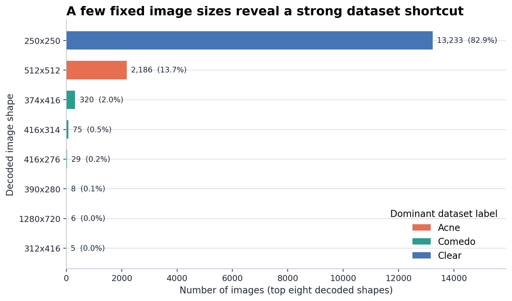
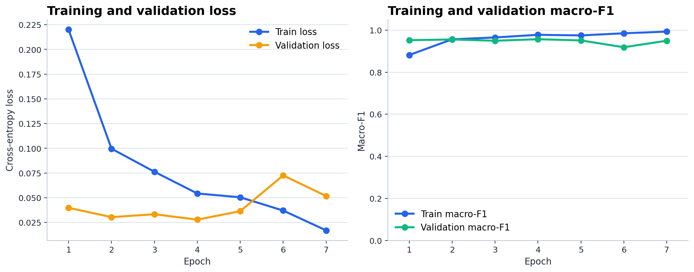
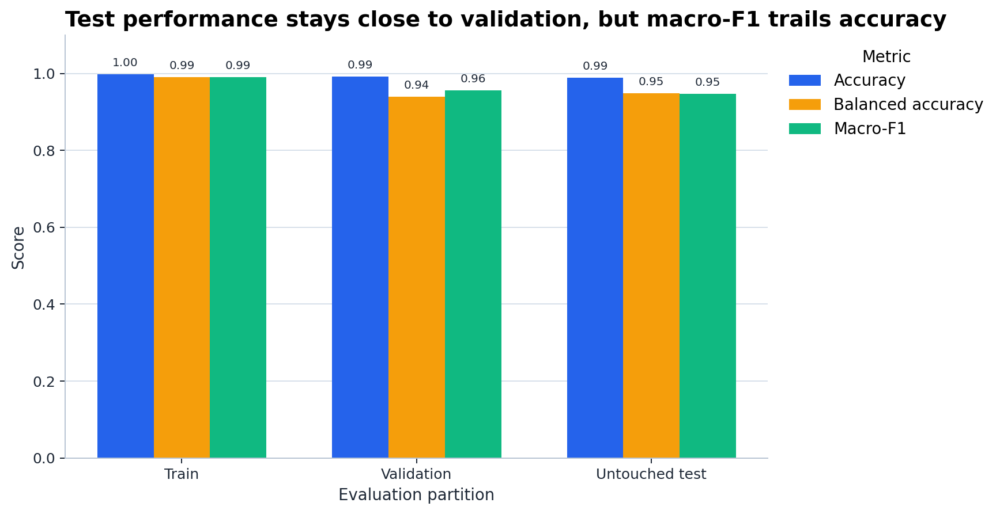

# DermaInsight AI

An academic image classifier for the dataset labels **Acne**, **Comedo**, and **Clear**. The single [training notebook](notebooks/acne_training.ipynb) audits the supplied images, plots exploratory data analysis (EDA), trains an EfficientNet-B0 convolutional neural network (CNN), evaluates a held-out test set, and exports the selected checkpoint. The [Flask app](app.py) loads that export to classify one uploaded image and show a Grad-CAM heatmap.

The task is **one label per image**. It does not draw boxes around individual spots, count lesions, grade severity, or provide a clinical diagnosis. A Grad-CAM heatmap shows coarse image regions associated with a class score; it is not a lesion mask. The word *Clear* is a label from this dataset, not a verified skin-health assessment.

## Project layout

```text
acne cnn/
├── app.py                     # Flask loading, validation, prediction, Grad-CAM
├── requirements.txt           # Local Windows/NVIDIA CUDA environment
├── RUN_GUIDE.md               # Detailed local and Colab execution instructions
├── notebooks/
│   └── acne_training.ipynb    # Entire audit, EDA, training, testing, export
├── dataset/Acne/              # Source Train/ and Validation/ folders (local)
├── model/                     # Best/last weights and Flask contract (generated)
├── output/
│   ├── charts/                # All 18 generated figures and sample galleries
│   ├── tables/                # Audit, split, history, evaluation, sample tables
│   ├── samples/               # Individual Grad-CAM examples (generated)
│   └── model/                 # Duplicate model export (generated)
├── reports/                   # Duplicate machine-readable reports (generated)
├── templates/                 # Minimal Flask pages
└── static/                    # Flask styling and browser behavior
```

The notebook is the source of the displayed results. Model files, original face images, large row-level manifests, and duplicate exports are excluded by [.gitignore](.gitignore). The charts and compact summary tables remain available for this README. To use Flask from a fresh checkout, run the notebook through its final export cell or supply the **complete, matching** `model/` export; a weight file alone is insufficient.

## Dataset and audit

The supplied data is attributed to Kaggle's [Face Datasets](https://www.kaggle.com/datasets/xtvgie/face-datasets/data) and is expected at `dataset/Acne/Train/{Acne,Comedo,Clear}/` and `dataset/Acne/Validation/{Acne,Comedo,Clear}/`. These source folders are audited and then regrouped into a new experiment split; the folder named `Validation` is **not** treated as the final test set.

| Source label | Images | Share |
|---|---:|---:|
| Acne | 2,027 | 12.70% |
| Comedo | 705 | 4.42% |
| Clear | 13,233 | 82.89% |
| **Total** | **15,965** | **100%** |

Every inspected image decoded. The audit found 11 exact duplicate hash groups containing 23 files; dropping extra copies leaves **15,953** images. Related filenames and `Clear` subject names are grouped before splitting, and the notebook checks that group IDs do not cross partitions. The [audit summary](output/tables/audit_summary.json) also records 101 source stems crossing the original source folders and 89 crossing source classes.

The dataset has a serious shortcut: all 13,233 `Clear` images are 250 × 250, while the 2,027 `Acne` images are 512 × 512. The audit's dimensions-only baseline reaches **99.00%** accuracy. This means a high image-classification score can reflect source or image-format differences rather than a reliable skin finding. The `Clear` filenames and image signature appear LFW-like; their clinical meaning has **not** been verified. These are exploratory dataset-label results, not evidence of real-world diagnostic performance.

The decoded-format table contains 15,957 JPEGs, 2 PNGs, and 6 WEBPs. The 8 PNG/WEBP files carry `.jpg` names. **Known audit-table issue:** [eda_integrity_checks.csv](output/tables/eda_integrity_checks.csv) reports 15,965 “extension/format mismatches” because its comparison treats `.jpg` and the decoder name `JPEG` as different strings. Do not interpret that row as 15,965 mislabeled files; [eda_format_summary.csv](output/tables/eda_format_summary.csv) gives the decoded formats.





These charts motivate grouped splitting, class-weighted training, and class-balanced metrics. The [format chart](output/charts/eda_formats_by_label.png) shows that the non-JPEG examples are in `Comedo`. Full EDA tables: [label counts](output/tables/eda_label_counts.csv), [decoded formats](output/tables/eda_format_summary.csv), [dimensions](output/tables/eda_dimension_summary.csv), [integrity checks](output/tables/eda_integrity_checks.csv), and [EDA conclusion](output/tables/eda_conclusion.md).

## Split and training method

After exact deduplication, `StratifiedGroupKFold` reserves approximately **20%** as an untouched test set. The remaining 80% is a training pool, with an internal validation subset for checkpoint selection and early stopping. Grouping keeps related images or `Clear` subjects together. The actual partition is:

| Partition | Acne | Comedo | Clear | Total | Share of clean data |
|---|---:|---:|---:|---:|---:|
| Train | 1,456 | 503 | 9,527 | 11,486 | 72.00% |
| Validation | 162 | 55 | 1,059 | 1,276 | 8.00% |
| Untouched test | 404 | 140 | 2,647 | 3,191 | 20.00% |

The [split chart](output/charts/split_class_counts.png), [split summary](output/tables/split_summary.csv), and [class counts](output/tables/split_class_counts.csv) preserve exact counts. The 80/20 request refers to the **training pool versus test**; train and validation together contain 12,762 images.

The selected network is torchvision **EfficientNet-B0**, a CNN that extracts visual features using convolutional blocks and ends in a three-output classification layer. The notebook requests ImageNet initialization when available, replaces the classifier for the three dataset labels, and otherwise falls back to random initialization. A small custom CNN is defined as an optional baseline, but it was **disabled in this saved run**; there is no measured custom-CNN comparison to report.

| Setting | Notebook value |
|---|---|
| Input and normalization | RGB; resize to 224 × 224; ImageNet mean `[0.485, 0.456, 0.406]` and standard deviation `[0.229, 0.224, 0.225]` |
| Train-only augmentation | Horizontal flip (0.5); mild brightness, contrast, and saturation jitter |
| Loss and imbalance handling | Weighted cross-entropy; weights derived from the training class counts |
| Optimizer and schedule | AdamW; learning rate `3e-4`; weight decay `1e-4`; plateau scheduler |
| Batch size and seed | 32; seed 42 |
| Selection rule | Highest validation macro-F1; early stopping after 3 non-improving epochs |
| Execution | CUDA for the saved full run; maximum requested epochs 12 |

`model/efficientnet_b0_last.pt` is updated after each completed epoch and contains optimizer/scheduler state for deliberate resume. `model/efficientnet_b0_best.pt` is updated only when validation macro-F1 improves. The test partition does not choose the checkpoint.

## Verified saved run

The local `model/model_metadata.json`, `model/run_state.json`, history, and selected checkpoint agree: run ID `20260818_203511`, profile `full`, device `cuda`, `training_run_is_smoke=false`, **12 epochs requested, 7 completed, epoch 4 selected**. Patience 3 stopped the run after epochs 5–7 failed to improve validation macro-F1. The best checkpoint's SHA-256 is `6614577eab1a486f77ccfb47974fc4ea8ee2683bb30a018475b674aef07a25a5`. These are the recorded results of this saved run; rerunning the notebook can produce different values.

| Epoch | Train loss | Validation loss | Train macro-F1 | Validation macro-F1 |
|---:|---:|---:|---:|---:|
| 1 | 0.2200 | 0.0398 | 0.8815 | 0.9520 |
| 2 | 0.0996 | 0.0304 | 0.9562 | 0.9554 |
| 3 | 0.0763 | 0.0333 | 0.9650 | 0.9494 |
| **4** | **0.0543** | **0.0279** | **0.9776** | **0.9567** |
| 5 | 0.0505 | 0.0364 | 0.9747 | 0.9509 |
| 6 | 0.0371 | 0.0726 | 0.9848 | 0.9185 |
| 7 | 0.0170 | 0.0518 | 0.9929 | 0.9494 |



The chart shows training fit continuing to improve while validation macro-F1 peaks at epoch 4. The complete epoch log, including learning rates, accuracies, and durations, is in [efficientnet_b0_training_history.csv](output/tables/efficientnet_b0_training_history.csv).

## Evaluation on the selected epoch-4 checkpoint

The notebook reloads the same best checkpoint and evaluates **all** train, validation, and test images with deterministic evaluation preprocessing. These are partition-wide metrics, separate from the sample galleries.

| Partition | Images | Accuracy | Balanced accuracy | Macro precision | Macro recall | Macro-F1 |
|---|---:|---:|---:|---:|---:|---:|
| Train | 11,486 | 99.80% | 99.12% | 98.98% | 99.12% | 99.05% |
| Validation | 1,276 | 99.22% | 93.94% | 98.06% | 93.94% | 95.67% |
| **Untouched test** | **3,191** | **98.93%** | **94.93%** | **94.54%** | **94.93%** | **94.73%** |

Accuracy counts all images equally and is inflated by the numerous `Clear` examples. Balanced accuracy averages recall across the three labels; macro-F1 averages the three class F1 scores. The train-to-test macro-F1 difference is about **4.31 percentage points**, and the test macro-F1 is lower than test accuracy, so the single headline accuracy is insufficient. The full comparison, including weighted F1, ROC-AUC, average precision, and log loss, is in [efficientnet_b0_performance_by_split.csv](output/tables/efficientnet_b0_performance_by_split.csv).



| True label ↓ / predicted → | Acne | Comedo | Clear |
|---|---:|---:|---:|
| Acne | 386 | 17 | 1 |
| Comedo | 15 | 125 | 0 |
| Clear | 0 | 1 | 2,646 |

The main confusion is between `Acne` and `Comedo`. [Confusion-matrix CSV](output/tables/efficientnet_b0_test_confusion_matrix.csv) and [chart](output/charts/evaluation_test_confusion_matrix.png) give the same counts.

| Test label | Precision | Recall | F1 | Images |
|---|---:|---:|---:|---:|
| Acne | 96.26% | 95.54% | 95.90% | 404 |
| Comedo | 87.41% | 89.29% | 88.34% | 140 |
| Clear | 99.96% | 99.96% | 99.96% | 2,647 |

The `Comedo` result is materially weaker than the `Clear` result. See the [per-class F1 chart](output/charts/evaluation_test_per_class_f1.png), [classification report](output/tables/efficientnet_b0_test_classification_report.csv), and [full-test metrics JSON](output/tables/efficientnet_b0_test_metrics.json).

## Example predictions and explanations

The 50-image professor gallery samples **20 Acne, 15 Comedo, and 15 Clear** images from the held-out test set; it scores 49/50 (98.00%). A separate 20-image detail set scores 19/20 (95.00%). These small sets are presentation examples, not replacements for the 3,191-image test result.

| Held-out example | True label | Predicted label | Top model score | Result |
|---|---|---|---:|---|
| `detailed_20_001` | Acne | Acne | 99.94% | Correct |
| `detailed_20_012` | Comedo | Acne | 50.40% | Incorrect |
| `detailed_20_015` | Clear | Clear | 100.00% (rounded) | Correct |

The [20-example prediction table](output/tables/detailed_20_test_predictions.csv) has every class score and correctness flag; [50-example table](output/tables/professor_50_test_samples.csv) holds the professor gallery choices. The example above shows why a score should not be read as diagnostic certainty. Grad-CAM is produced for examples as a **coarse class-attention overlay**, without bounding boxes or precise lesion locations.

All 18 generated figures are listed here. The galleries contain faces from the supplied dataset; review sharing rights before publishing those figures.

| Figure(s) | What they show |
|---|---|
| [Class distribution](output/charts/eda_class_distribution.png) | Strong `Clear` majority |
| [Dimensions by label](output/charts/eda_dimensions_by_label.png) | Source-size shortcut |
| [Decoded formats by label](output/charts/eda_formats_by_label.png) | Non-JPEG files in `Comedo` |
| [Split class counts](output/charts/split_class_counts.png) | Label mix in each new partition |
| [Training history](output/charts/training_history.png) | Loss and macro-F1 over 7 epochs |
| [Performance comparison](output/charts/evaluation_performance_comparison.png) | Train, validation, and test scores |
| [Test confusion matrix](output/charts/evaluation_test_confusion_matrix.png) | Counts for each true/predicted pair |
| [Test F1 by class](output/charts/evaluation_test_per_class_f1.png) | Minority-class performance |
| [Small test prediction grid](output/charts/samples_test_prediction_grid.png) | Example inputs and model labels |
| [50 gallery: page 1](output/charts/professor_50_prediction_gallery_page_1.png), [2](output/charts/professor_50_prediction_gallery_page_2.png), [3](output/charts/professor_50_prediction_gallery_page_3.png), [4](output/charts/professor_50_prediction_gallery_page_4.png), [5](output/charts/professor_50_prediction_gallery_page_5.png) | Fifty held-out examples across five pages |
| [20 prediction gallery: page 1](output/charts/detailed_20_prediction_gallery_page_1.png), [2](output/charts/detailed_20_prediction_gallery_page_2.png) | Twenty detailed predictions |
| [20 Grad-CAM gallery: page 1](output/charts/detailed_20_gradcam_gallery_page_1.png), [2](output/charts/detailed_20_gradcam_gallery_page_2.png) | Coarse class-attention overlays for the twenty examples |

Other generated tables: [50-example summary](output/tables/professor_50_summary.csv), [20-example metrics](output/tables/detailed_20_test_metrics.csv), [20 Grad-CAM index](output/tables/detailed_20_gradcam_examples.csv), [small test prediction grid data](output/tables/sample_test_predictions.csv), [small Grad-CAM index](output/tables/gradcam_examples.csv), [Flask export manifest](output/tables/flask_export_manifest.csv), [output manifest](output/tables/output_manifest.json), and [final conclusion](output/tables/final_conclusion.md). The notebook also writes row-level `output/tables/dataset_manifest.csv`, `clean_split_manifest.csv`, and `efficientnet_b0_test_predictions.csv` locally; these contain image paths and are ignored by Git. `reports/` contains duplicated machine-readable exports and is also ignored.

## Run the notebook and Flask app

For the documented **Windows/NVIDIA** setup, from this folder in PowerShell:

```powershell
python -m venv .venv-gpu
.\.venv-gpu\Scripts\python.exe -m pip install --upgrade pip
.\.venv-gpu\Scripts\python.exe -m pip install -r requirements.txt
.\.venv-gpu\Scripts\python.exe -c "import torch; print(torch.__version__, torch.cuda.is_available(), torch.cuda.get_device_name(0))"
```

The last command should report CUDA availability before a full training run. Open [acne_training.ipynb](notebooks/acne_training.ipynb) in Jupyter or VS Code with that environment's kernel and run all cells. The notebook also contains `%pip` for common packages; `requirements.txt` supplies the pinned local CUDA build. For Google Colab, select a GPU runtime, upload/mount the project so `dataset/Acne` is reachable, set `ACNE_PROJECT_ROOT` and `ACNE_DATASET_ROOT` if necessary, and follow [RUN_GUIDE.md](RUN_GUIDE.md); Colab uses its own CUDA-enabled PyTorch installation.

Once the final notebook cell writes `model/run_state.json` with `status: completed`, start Flask:

```powershell
.\.venv-gpu\Scripts\python.exe app.py
```

Open `http://127.0.0.1:5000/`. The minimal black-and-white interface has an upload page and an About page. On startup it checks the completed run, rejects a smoke export, verifies the selected checkpoint's SHA-256, and loads the model in the background. Upload a JPG, JPEG, PNG, or WEBP image (maximum 12 MB). The page shows the input, one dataset label, three softmax scores, a Grad-CAM overlay, and live progress messages. Inference can use GPU when available or CPU for a completed export. Flask never trains or changes the weights.

For a JSON response from a local image:

```powershell
curl.exe -F "image=@C:\path\to\face.jpg" "http://127.0.0.1:5000/predict?format=json"
```

The JSON includes `prediction`, `confidence`, per-class `probabilities`, image metadata, an explanation, and a base64-encoded `explanation_image`. A softmax score is a model score, not a calibrated medical probability. The exact requirements, resume procedure, and Colab configuration are in [RUN_GUIDE.md](RUN_GUIDE.md).

## Interpretation limit

This experiment measures how well one CNN reproduces labels in this particular dataset under a grouped holdout. The severe label imbalance, image-size/source shortcut, and unverified `Clear` label limit what its 98.93% test accuracy can mean outside this dataset. Exact lesion localization would require lesion-level boxes or masks and a different detector or segmentation task. Any clinical claim would require better labels and independent external validation.
